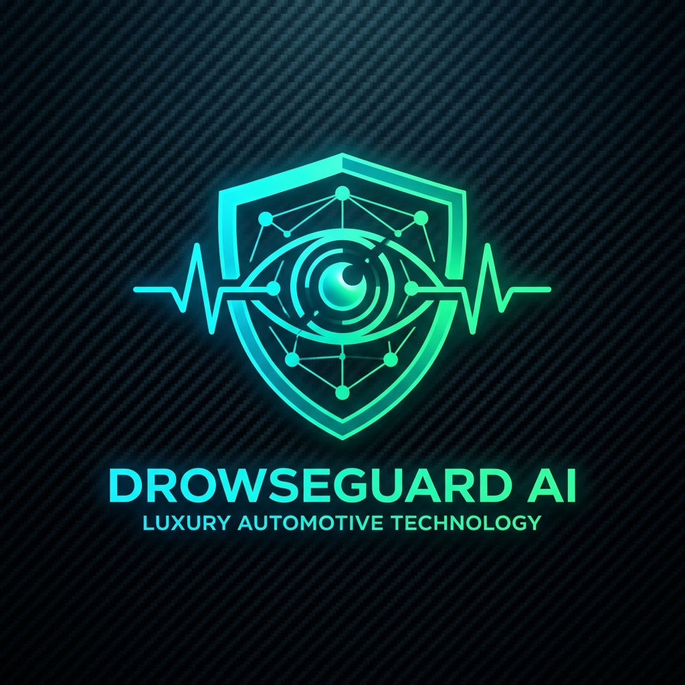
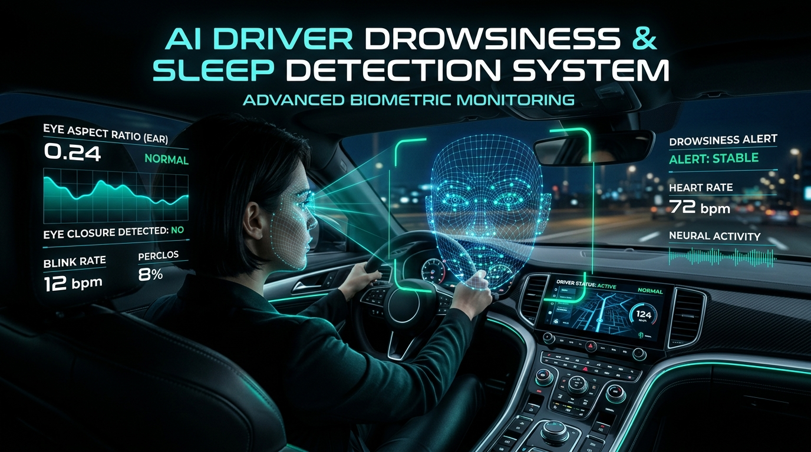
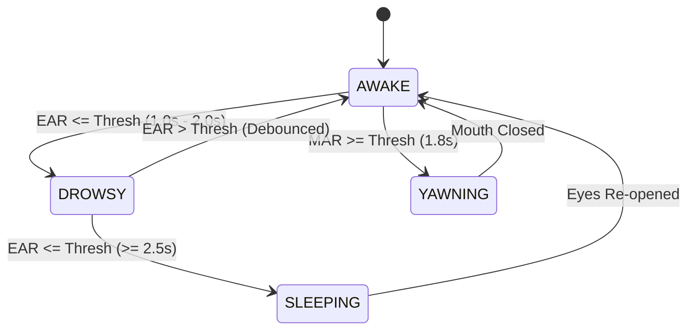

<div align="center">

  

  # 🚗 DROWSEGUARD AI
  ### Next-Gen Real-Time Driver Sleep & Drowsiness Detection System
  
  [](https://python.org)
  [](https://developers.google.com/mediapipe)
  [](https://opencv.org)
  [](https://streamlit.io)
  [](https://plotly.com)
  [](LICENSE)

  <br />

  <p align="center">
    <b>A production-grade Computer Vision system engineered to safeguard drivers against fatigue, microsleeps, and inattentiveness using real-time facial landmark biomechanics, 3D head pose estimation, and temporal state analytics.</b>
  </p>

  <br />

  

</div>

---

## 🌟 Key Highlights

- 👁️ **Dual Eye Aspect Ratio (EAR)**: Computes precise vertical-to-horizontal eye closure ratios across 6 facial landmarks per eye with adaptive calibration.
- 🥱 **Multi-Point Mouth Aspect Ratio (MAR)**: Multi-vector yawn detection analyzing vertical lip displacement to detect early signs of driver fatigue.
- 📐 **3D Head Pose Estimation**: Computes driver head orientation (Pitch, Yaw, Roll) via 3D facial mesh points to detect head nodding, micro-sleep slumps, and road distractions.
- 🧠 **Temporal State Machine**: Multi-state debounce architecture eliminating false positives by confirming duration thresholds (`AWAKE` ➔ `DROWSY` ➔ `SLEEPING`).
- ⚡ **Composite Drowsiness Risk Index (0–100%)**: Multi-sensor fusion engine scoring real-time driver danger based on weighted eye closure, yawn frequency, blink rate anomalies, and posture.
- 🔊 **Bimodal Alarm System**: Real-time auditory warning & critical sirens with cross-platform desktop synthesis (`winsound`/PowerShell) and HTML5 web audio fallbacks.
- 🎮 **Cockpit UI & Live HUD**: High-tech automotive telemetry interface with live status badge indicators, responsive non-truncating controls, and interactive Plotly graphs.
- 📹 **Flexible Video Pipeline**: Works seamlessly on **Live Webcam Streams** or **Recorded MP4/AVI Files** with graceful playback completion.
- 📊 **Telemetry Logs & CSV Export**: Continuous session recording with instant CSV export for post-drive fatigue analysis.

---

## 📐 Scientific & Mathematical Foundations

### 1. Eye Aspect Ratio (EAR)
The Eye Aspect Ratio quantifies the degree of eyelid opening using 6 Euclidean landmarks per eye:

$$\text{EAR} = \frac{\|P_2 - P_6\| + \|P_3 - P_5\|}{2 \cdot \|P_1 - P_4\|}$$

- **Open Eye**: $\text{EAR} \approx 0.28 - 0.35$
- **Closed Eye**: $\text{EAR} \le 0.20$
- **Debounced Blink Detection**: A brief closure ($< 0.5\text{s}$) registers as a natural blink; prolonged closure triggers fatigue states.

```
       P2      P3
        •──────•
  P1 •            • P4   (Horizontal distance: ||P1 - P4||)
        •──────•
       P6      P5
```

---

### 2. Mouth Aspect Ratio (MAR)
To detect prolonged yawning, the vertical separation of the lips is normalized against the mouth width across 8 landmarks:

$$\text{MAR} = \frac{\|V_{\text{top}} - V_{\text{bot}}\| + \|V_{\text{top,L}} - V_{\text{bot,L}}\| + \|V_{\text{top,R}} - V_{\text{bot,R}}\|}{3 \cdot \|H_{\text{left}} - H_{\text{right}}\|}$$

- **Normal Mouth**: $\text{MAR} < 0.50$
- **Yawn Condition**: $\text{MAR} \ge 0.65$ sustained for $> 1.8\text{ seconds}$

---

### 3. Temporal State Machine Architecture



| State | Primary Criterion | Visual HUD Alert | Audio Siren |
| :--- | :--- | :--- | :--- |
| **`AWAKE`** | $\text{EAR} > 0.22$ | 🟢 Emerald HUD Banner | None |
| **`DROWSY`** | $\text{EAR} \le 0.22$ for $\ge 1.0\text{s}$ | 🟠 Amber Warning Border | Periodic Warning Pulse |
| **`SLEEPING`** | $\text{EAR} \le 0.22$ for $\ge 2.5\text{s}$ | 🔴 Flashing Critical Crimson | Continuous Critical Siren |
| **`YAWNING`** | $\text{MAR} \ge 0.65$ for $\ge 1.8\text{s}$ | 🟣 Violet Alert Pill | Advisory Tone |

---

### 4. Drowsiness Risk Score (0–100%) Fusion Matrix

$$\text{Risk Score} = \omega_{\text{eye}} \cdot S_{\text{eye}} + \omega_{\text{yawn}} \cdot S_{\text{yawn}} + \omega_{\text{blink}} \cdot S_{\text{blink}} + \omega_{\text{pose}} \cdot S_{\text{pose}}$$

| Metric Component | Weight ($\omega$) | Description |
| :--- | :---: | :--- |
| **Eye Closure Duration** | **50%** | Non-linear scale mapping closure seconds to fatigue level |
| **Yawn Frequency** | **20%** | Exponential decay penalty for consecutive yawns |
| **Blink Rate Anomaly** | **18%** | Divergence from typical resting baseline (12–20 blinks/min) |
| **Head Nodding / Tilt** | **12%** | Significant Pitch downward ($< -18^\circ$) or Roll tilt ($> 22^\circ$) |

---

## 🗂️ Project Architecture

```
Sleep Drowness Ai/
├── assets/                       # Branding visuals & documentation graphics
│   ├── banner.png                # High-res futuristic dashboard header
│   └── logo.png                  # Cybernetic eye shield emblem logo
├── .audio_cache/                 # Pre-generated WAV audio alert files
├── app.py                        # Streamlit Cockpit Web App & Orchestrator
├── detector.py                   # MediaPipe Face Landmarker API wrapper
├── metrics.py                    # EAR, MAR, Head Pose, & Biometric calculations
├── state_machine.py              # Temporal debouncing & drowsiness scoring engine
├── visualizer.py                 # Real-time HUD overlays & telemetry bounding boxes
├── audio.py                      # Multi-channel audio alert synthesizers
├── config.py                     # Centralized configuration dataclasses & landmarks
├── requirements.txt              # Production dependency specifications
├── sample_driver.mp4             # Built-in synthetic test video
└── README.md                     # Project documentation
```

---

## 🚀 Quick Start Guide

### Prerequisites
- **Python**: Version `3.10` or higher
- **Webcam**: Standard USB or integrated laptop webcam (optional for file mode)

### 1. Clone & Set Up Environment

```bash
# Clone the repository
git clone https://github.com/your-username/drowseguard-ai.git
cd drowseguard-ai

# Create and activate virtual environment
python -m venv venv

# Windows:
venv\Scripts\activate

# macOS / Linux:
source venv/bin/activate
```

### 2. Install Dependencies

```bash
pip install -r requirements.txt
```

> **Note**: On the first launch, the official MediaPipe `face_landmarker.task` weights bundle (~3.7 MB) is automatically downloaded and verified.

### 3. Launch DrowseGuard Cockpit

```bash
streamlit run app.py
```

Open your browser to:
👉 **`http://localhost:8501`**

---

## 🎮 Cockpit Interface Guide

<div align="center">
  
</div>

1. **Source Selection (Sidebar)**:
   - **Webcam (Live)**: Monitors your live face with real-time HUD telemetry.
   - **Upload Video File**: Inspects MP4/AVI dashcam or test videos with automatic playback completion.
   - **Sample Demo Video**: Runs an included synthetic demonstration clip.
2. **Tactile Cockpit Buttons**:
   - `▶ START DETECTION`: Starts detection loop with glowing neon pulse animation.
   - `⏹ STOP`: Instantly halts processing and releases camera/video stream.
   - `🔄 RESET`: Clears all metrics, blink counters, and session logs.
3. **Telemetry Dashboard**:
   - Real-time gauge for **Drowsiness Risk Score (0–100%)**.
   - Metric chips for **EAR**, **MAR**, **Blinks/min**, and **Head Pose**.
4. **Analytics Tab**:
   - Time-series charts for EAR and MAR progression.
   - State distribution donut graph.
   - CSV Download button to export high-frequency telemetry.

---

## 🛠️ Tech Stack & Libraries

| Technology | Purpose |
| :--- | :--- |
| **[MediaPipe](https://developers.google.com/mediapipe)** | 478 3D facial landmark mesh estimation |
| **[OpenCV](https://opencv.org/)** | Video I/O, perspective calculations, and HUD rendering |
| **[Streamlit](https://streamlit.io/)** | High-performance dashboard with custom CSS glassmorphism |
| **[Plotly](https://plotly.com/)** | Interactive telemetry graphs and state distribution charts |
| **[NumPy](https://numpy.org/) / [SciPy](https://scipy.org/)** | Vectorized landmark distance calculations and EMA smoothing |

---

## 🛡️ License

This project is licensed under the **MIT License** — see the [LICENSE](LICENSE) file for details.

---

<div align="center">
  <sub>Engineered with precision for Computer Vision & Automotive Safety Portfolios.</sub>
</div>
